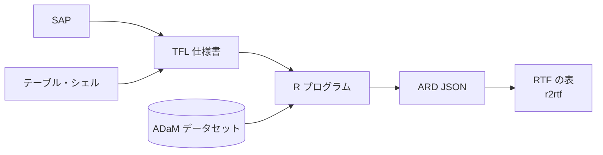

# Clindroid Buddy

**臨床統計プログラミングのための AI コーディングエージェント**

[English](./README.md) | 日本語

開発: [Clindroid](https://clindroid.com)

Clindroid Buddy は、治験の総括報告書に載せる図表を作成する統計プログラマーのための、ターミナルで動く AI エージェントです。SAP、テーブル・シェル、ADaM データセットを渡すと、TFL 仕様書を作成し、R プログラムを生成して実行し、結果を仕様書とシェルに照らして確認したうえで、表を RTF に出力します。

LLM はローカルでも動かせるので、被験者レベルのデータを自社のインフラの外に出す必要はありません。

https://github.com/user-attachments/assets/e6f1e3dc-fddc-4251-b0c8-10a12c7b07d5

ナレーション付きの [12 分のデモ動画全編は YouTube でご覧いただけます](https://youtu.be/Cd9Yi2Ne98E)。

## Clindroid Buddy の特長

**お手元の文書をもとに作業します。** TFL 仕様書は SAP とシェルから作成します。各解析項目を変数に対応づけるために、スキルが ADaM データセットから読むのは列名とラベル（と投与群名）だけです。仕様書の作成中にデータを集計したり一覧にしたりはしないので、途中時点のデータの件数が仕様書に入り込むことはありません。

**自分の作業を自分で確認します。** 表を作るスキルは、コードを書いて終わりにはしません。R プログラムを実行し、TFL 仕様書とシェルを読み直して、出力と照らし合わせます。食い違いがあればプログラムを直して再実行し、そのうえで表の完成を報告します。

**追跡可能な出力を残します。** すべての表は、表示する値を一つずつ記録した機械可読の ARD JSON として書き出され、RTF はその JSON から r2rtf で作成されます。

**試験フォルダの構成を理解しています。** 一つのコマンドで標準的な試験フォルダの構成を作成でき、エージェントは SAP、シェル、仕様書、データセット、プログラムをそれぞれどこに置くべきかを把握しています。

**中規模のモデルでも高い精度を実現します。** 作業をモデルの判断に任せきりにはしません。スキルが各手順、統計手法、使う R コードを具体的に示し、すべてのプログラムは実行されて仕様書とシェルに照らして確認されてから完成と報告されます。そのため、自社のハードウェアで動かせる Gemma 4 31B 程度の大きさのモデルでも、高い精度で表を作成できます。

**データをどこで扱うかを選べます。** すべてを自社のマシンの中で完結させたい場合は、推奨のローカル実行環境である Ollama でモデルを動かせば、クラウドのプロバイダーには何も送られません。マネージドなクラウドサービスを使いたい場合は、Amazon Bedrock を推奨のリモート実行環境としています。OpenAI 互換 API に対応したほかのサーバーでも動作するはずですが、検証はしていません。

**エージェントは自分の担当範囲から出ません。** TFL エージェントが書き込めるのは TFL 仕様書と TFL プログラムだけです。SDTM エージェントは ADaM や TFL のファイルを読めず、review エージェントは何も編集できません。この制限はツールの権限設定で強制されるので、プロンプトに書き忘れても効きます。

## SAP から RTF まで



1. **TFL 仕様書。** レイアウトはテーブル・シェルから、解析内容は SAP から読み取り、各解析項目を ADaM 変数に対応づけます。仕様書には、解析対象集団、合計列、p 値の算出方法、脚注、カテゴリの表示順、小数点以下の桁数が含まれます。
2. **表のプログラム。** TFL 仕様書から R（tidyverse）のプログラムを生成して ADaM データセットに対して実行し、結果を仕様書とシェルの両方に照らして確認してから報告します。
3. **出力。** すべての表は機械可読の ARD JSON として書き出され、r2rtf で RTF に出力されます。

## インストール

Clindroid Buddy は、安全のために Docker コンテナの中で動かします。Clindroid Buddy があなたに代わって実行するシェルコマンドや R プログラムが触れられる範囲を、コンテナで限定するためです（詳しくは「[Docker で実行する](#docker-で実行する)」をご覧ください）。

イメージは Docker Hub で [`clindroid/clindroidbuddy`](https://hub.docker.com/r/clindroid/clindroidbuddy) として公開しています。バージョンのタグを付けて取得してください。

```bash
docker pull clindroid/clindroidbuddy:0.1.0
```

環境変数の設定、`compose.yaml` の用意、試験フォルダへの設定ファイルの配置は、ユーザーガイドの [1. はじめに](https://clindroid.com/jp/products/buddy/docs/getting-started#11-前提) の 1.1〜1.5 に沿って進めてください。macOS と Windows のそれぞれについて説明しています。

## クイックスタート

[1.6 起動する](https://clindroid.com/jp/products/buddy/docs/getting-started#16-起動する) に沿って Clindroid Buddy を起動し、[1.7 動作確認](https://clindroid.com/jp/products/buddy/docs/getting-started#17-動作確認) でセットアップを確かめてください。最初のセッションで使うキー操作は [1.8 TUI の基本操作](https://clindroid.com/jp/products/buddy/docs/getting-started#18-tui-の基本操作) にまとめています。

## Docker で実行する

Clindroid Buddy は、あなたに代わってシェルコマンドや R プログラムを実行します。コンテナの中で動かすと、それらのコマンドが触れられる範囲を限定できます。

- **見えるのは試験フォルダだけです。** コンテナからアクセスできるのは、マウントした試験フォルダとセッションデータ用のフォルダだけです。ホームディレクトリ、SSH 鍵、クラウドの認証情報、ほかのプロジェクトはコンテナの外に置かれたままです。
- **権限のないユーザーとして動きます。** コンテナの中では、Clindroid Buddy は root ではないユーザー `buddy` として動きます。
- **お手元の環境を汚しません。** R、tidyverse、r2rtf はイメージにあらかじめ入っており、エージェントが追加でインストールするパッケージもお手元のマシンではなくコンテナの中に入ります。

「エージェント」の節で説明している権限の制限は、コンテナの中でもそのまま効きます。ただし、マウントした試験フォルダの中のファイルそのものはコンテナでは守られないので、そのフォルダはバージョン管理するかバックアップを取ってください。また、標準の設定ではネットワークへのアクセスは制限されません。

イメージは Docker Hub で公開しています。イメージの取得、`compose.yaml`、設定ファイル、起動の手順は、ユーザーガイドの [1. はじめに](https://clindroid.com/jp/products/buddy/docs/getting-started) をご覧ください。macOS と Windows のそれぞれについて説明しています。コンテナの中では、`clinbuddy` コマンドで Clindroid Buddy を起動します。

## エージェント

| エージェント | 役割 | 書き込める場所 |
|---|---|---|
| **SDTM** | SDTM IG と Controlled Terminology に沿った SDTM ドメインの作業 | `data/sdtm/`, `docs/specs/sdtm/`, `programs/sdtm/` |
| **ADaM** | ADaM IG に沿った ADSL / BDS / OCCDS の作業（SDTM へのトレーサビリティ付き） | `data/adam/`, `docs/specs/adam/`, `programs/adam/` |
| **TFL** | SAP とシェルにもとづく TFL 仕様書と表のプログラムの作成 | `docs/specs/tfls/`, `programs/tfls/` |
| **review** | コード、データ、成果物をレビューして指摘を報告 | なし |
| **build** | すべての操作ができる汎用エージェント | すべて（権限設定の範囲内） |
| **plan** | 読み取り専用の分析と計画 | 計画ファイルのみ |

臨床系のエージェントはいずれも `AGENTS.md` も更新できます。複数の手順にわたる調査やコード検索には、**general** と **explore** の二つのサブエージェントを使えます。`@general` または `@explore` で呼び出してください。

## スキル

| スキル | 用途 |
|---|---|
| `tfl-spec-writer` | シェル + SAP → TFL 仕様書 |
| `clinical-categorical-single-factor` | カテゴリ変数の n (%) の表（カイ二乗検定、Fisher の正確検定、Fisher-Freeman-Halton 検定の p 値付き） |
| `clinical-bds-multi-param` | BDS データセットからのパラメータごとのテーブル（臨床検査値など） |
| `r-coder-complex-table` | ADaM データセットから作るそのほかのテーブル |
| `clindroid-ard-json` | すべての表のプログラムが書き出す ARD JSON のスキーマ |
| `clindroid-rtf-rendering` | ARD JSON から r2rtf で RTF ファイルを作る方法 |

## AGENTS.md による試験ごとの規約

`/init` コマンドを実行すると、試験フォルダに `AGENTS.md` が追加され、すべてのエージェントがセッションの開始時にこれを読み込みます。自社の SOP に合わせて編集しておけば、エージェントはどの依頼でもその基準に従います。

**プログラムの一貫性。** すべてのプログラムが同じ構成とスタイルに従うので、QC、ダブルプログラミング、引き継ぎがしやすくなります。

**申請への備え。** ファイルの置き場所が決まっており、規制当局に提出する可能性のあるファイル名はすべて小文字です。

**再現性と追跡可能性。** プログラムはパッケージのバージョンを固定し、R の実行環境をログに残し、変更履歴と、各出力を SAP までたどれるコメントを含みます。

これらはエージェントが従う指示であって、ツールが強制するチェックではないので、QC で確認してください。

## 標準規格ツール

Clindroid Buddy は、お手持ちのライセンス済みの ADaM IG と SDTM IG をインデックス化してローカルで検索できます。これにより、エージェントは作業中に IG の本文を参照できます。IG をダウンロードすることはありません。PDF または DOCX のファイルを `docs/standards/adam/` と `docs/standards/sdtm/` に置き、設定に埋め込みモデルを追加して、インデックスを作成してください。

```jsonc
{
  "provider": {
    "ollama": {
      "npm": "@ai-sdk/openai-compatible",
      "name": "Ollama",
      "options": { "baseURL": "http://localhost:11434/v1" },
      "models": {
        "nomic-embed-text": { "name": "nomic-embed-text" }
      }
    }
  },
  "rag": { "embeddingModel": "ollama/nomic-embed-text" }
}
```

```text
/index-standard-docs adam
/index-standard-docs sdtm
```

この例では埋め込みモデルをローカルの Ollama サーバーで動かす（`ollama pull nomic-embed-text`）ので、IG の本文がお手元のマシンの外に出ることはありません。Docker コンテナの中では、代わりにイメージに同梱の埋め込みモデルを使ってください（ユーザーガイドの [1.5](https://clindroid.com/jp/products/buddy/docs/getting-started#15-試験フォルダに設定ファイルを置く) を参照）。

Controlled Terminology のパッケージは、NCI EVS から `dict/` にダウンロードできます。`/download-adam-terminology` は、`AGENTS.md` に記載された ADaM のパッケージをダウンロードします。SDTM や Define-XML の Terminology は、必要なバージョンのダウンロードをエージェントに依頼してください（例:「SDTM terminology 2026-03-27 をダウンロードして」）。

## 対象範囲と制限事項

どれほど大きなモデルを使っても、AI の出力が常に正しいとは限りません。Clindroid Buddy は仕様書やプログラムを作成しますが、QC のプロセスに代わるものではありません。規制当局への申請に使う前に、すべての仕様書、プログラム、出力を、自社の SOP に従ってレビューし、バリデーションしてください。

現在のリリースが対象とするのは、SAP とシェルから RTF までのテーブルの作成です。プログラムは R でのみ生成します。リスティング、図、SDTM・ADaM データセットの作成には専用のスキルはまだありませんが、エージェントはそうした作業も手伝えます。表を作るスキルは、ADaM に準拠したデータセットが入力されることを前提としています。

Clindroid Buddy は Gemma 4 31B で開発・テストしており、ほかのモデルでは結果が異なる場合があります。

## 設定

設定ファイルの JSON Schema はバイナリに組み込まれているので、エディタでの検証はオフラインでも動き、常にインストール済みのバージョンと一致します。`clinbuddy schema` でスキーマを表示し、`clinbuddy schema --out <path>` でプロジェクトの設定ファイルの隣に書き出せます。

そのほかの情報は、[ユーザーガイド](https://clindroid.com/jp/products/buddy/docs/)の [6. 設定](https://clindroid.com/jp/products/buddy/docs/configuration) をご覧ください。

## コントリビューション

機能の要望やバグの報告は GitHub Issues で受け付けています。現時点ではコードのコントリビューションは受け付けていませんが、プロジェクトへの関心に感謝します。

## 謝辞

Clindroid Buddy は [OpenCode](https://github.com/anomalyco/opencode) をもとに作られています。このプロジェクトを可能にした優れた土台を提供してくださった OpenCode チームに感謝します。

IG 検索のためのローカルの埋め込みには [llama.cpp](https://github.com/ggml-org/llama.cpp) を使えます。サードパーティーの帰属表示は [THIRD_PARTY_NOTICES.md](./THIRD_PARTY_NOTICES.md) をご覧ください。

## ライセンス

Clindroid Buddy 全体は [GNU Affero General Public License v3.0 or later](./LICENSE)（AGPL-3.0-or-later）でライセンスされています。

このコードベースのうち OpenCode に由来する部分は、引き続き OpenCode の元の MIT ライセンスのもとで利用できます。その全文は [LICENSE-MIT](./LICENSE-MIT) と [THIRD_PARTY_NOTICES.md](./THIRD_PARTY_NOTICES.md) にそのまま収録しています。
