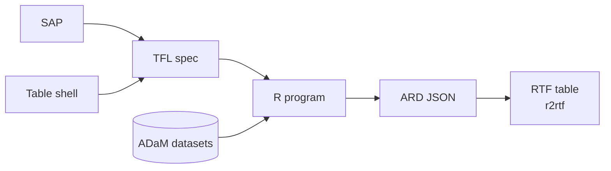

# Clindroid Buddy

**The AI coding agent for clinical statistical programming.**

English | [日本語](./README.ja.md)

Developed by [Clindroid](https://clindroid.com).

Clindroid Buddy is a terminal-based AI agent for statistical programmers who build the tables of a
clinical study report. Give it your SAP, the table shell and your ADaM datasets. It writes the TFL
specification, generates the R program, runs it, checks the result against the spec and the shell,
and renders the table to RTF.

It runs against a local LLM if you want it to, so subject-level data never has to leave your
own infrastructure.

<!-- TODO: replace the placeholder line below with the user-attachments URL of
clindroid_buddy_demo_30s.mp4. Drag the file into a GitHub issue or PR comment to get the URL,
then put the bare URL on its own line so GitHub renders it as a video player. -->
_Placeholder: 30-second demo video._

Watch the [full 12-minute demo with narration on YouTube](https://youtu.be/Cd9Yi2Ne98E).

## Why Clindroid Buddy

**It works from your documents.** The TFL specification comes from the SAP and the shell. The
skill reads only the column names and labels of the ADaM datasets (and the treatment group names)
to map each analysis item to its variable. It never counts or lists the data while it writes the
spec, so counts from an interim snapshot of the data don't end up in the spec.

**It checks its own work.** The table skills don't stop at writing code. They run the R program,
read the TFL spec and the shell back, and check the output against them. If something doesn't
match, they fix the program and run it again before reporting the table as done.

**It produces traceable output.** Every table is written as ARD JSON, a machine-readable record of
each displayed value, and the RTF is rendered from that JSON with r2rtf.

**It knows what a study looks like.** One command sets up a standard study folder structure, and
the agents know where the SAP, the shells, the specs, the datasets and the programs belong.

**It achieves high accuracy with a mid-sized model.** The work isn't left to the model's judgment.
The skills spell out each step, the statistical methods and the R code to use, and every program is
run and checked against the spec and the shell before it's reported done. That's why a model the
size of Gemma 4 31B, small enough to run on your own hardware, can produce tables with high
accuracy.

**You choose where your data goes.** To keep everything on your own machine, run the model locally
with Ollama, the recommended local runtime, and nothing goes out to a cloud provider. When you need
a managed cloud service instead, Amazon Bedrock is the recommended remote runtime. Other servers
that speak the OpenAI-compatible API should also work, but we haven't tested them.

**Each agent stays in its own lane.** The TFL agent can only write TFL specs and TFL programs. The
SDTM agent can't read ADaM or TFL files, and the review agent can't edit anything. The guardrails
are enforced by the tool permissions, so they don't depend on what you remember to put in the
prompt.

## From SAP to RTF



1. **TFL specification.** Reads the table shell for the layout and the SAP for the analysis, and
   maps each analysis item to its ADaM variable. The resulting spec covers populations, Total
   columns, p-value methods, footnotes, factor-level order and decimal precision.
2. **Table program.** Generates an R (tidyverse) program from the TFL spec, runs it against your
   ADaM datasets, and checks the result against both the spec and the shell before it reports back.
3. **Output.** Every table is written as machine-readable ARD JSON and rendered to RTF with r2rtf.

## Installation

<!-- TODO: replace with a link to the installation guide on the external site -->
_Placeholder: link to the installation guide._

## Quick start

<!-- TODO: replace with a link to the quick start guide on the external site -->
_Placeholder: link to the quick start guide._

## Running in Docker

Clindroid Buddy runs shell commands and R programs on your behalf. Running it in a container limits
what those commands can reach:

- **It sees only your study folder.** The container can access the study folder and the session
  data folder you mount into it. Your home directory, SSH keys, cloud credentials and other
  projects stay outside it.
- **It runs as an unprivileged user.** Inside the container, Clindroid Buddy runs as the non-root
  user `buddy`.
- **Your machine stays clean.** R, the tidyverse and r2rtf come preinstalled in the image, and any
  package an agent installs goes into the container rather than onto your machine.

The agent permissions described under Agents still apply inside the container. The container
doesn't protect the files in the mounted study folder itself, so keep that folder under version
control or backed up. Network access isn't restricted by default.

The image is published on Docker Hub. For getting the image, the `compose.yaml`, the config
file and the launch steps, see [1. Getting Started](https://clindroid.com/products/buddy/docs/getting-started) in the
user guide, which covers macOS and Windows. Inside the container, you start Clindroid Buddy
with the `clinbuddy` command.

## Agents

| Agent | What it does | Can write to |
|---|---|---|
| **SDTM** | SDTM domain work per the SDTM IG and Controlled Terminology | `data/sdtm/`, `docs/specs/sdtm/`, `programs/sdtm/` |
| **ADaM** | ADSL / BDS / OCCDS work per the ADaM IG, with traceability back to SDTM | `data/adam/`, `docs/specs/adam/`, `programs/adam/` |
| **TFL** | TFL specs and table programs driven by the SAP and the shells | `docs/specs/tfls/`, `programs/tfls/` |
| **review** | Reviews code, data and deliverables and reports findings | nothing |
| **build** | General-purpose agent with full access | everything (per your permissions) |
| **plan** | Read-only analysis and planning | plan files only |

All clinical agents can also update `AGENTS.md`. Two subagents, **general** and **explore**, are
available for multi-step research and code search. You can call them with `@general` or `@explore`.

## Skills

| Skill | Purpose |
|---|---|
| `tfl-spec-writer` | Shell + SAP → TFL spec |
| `clinical-categorical-single-factor` | n (%) tables for categorical variables, with chi-square, Fisher's exact or Fisher-Freeman-Halton p-values |
| `clinical-bds-multi-param` | Per-parameter summary tables from BDS datasets (e.g. laboratory parameters) |
| `r-coder-complex-table` | Other summary tables built from ADaM datasets |
| `clindroid-ard-json` | The ARD JSON schema every table program writes |
| `clindroid-rtf-rendering` | How ARD JSON becomes an RTF file through r2rtf |

## Study conventions in AGENTS.md

The `/init` command adds an `AGENTS.md` to each study folder, and every agent reads it at the start of every
session. Edit it to match your SOPs, and the agents follow your standards in every request.

**Consistent programs.** Every program follows the same structure and style, which makes QC,
double programming and handover easier.

**Ready for submission.** Files have fixed locations, and file names that may go to a regulator
are all lowercase.

**Reproducible and traceable.** Programs pin package versions, log the R environment, and carry
change histories and comments that trace each output back to the SAP.

These are instructions the agents follow, not checks the tool enforces, so confirm them in QC.

## Standards tools

Clindroid Buddy can also index your licensed copies of the ADaM and SDTM IGs and search them
locally, so an agent can look up the IG text while it works. It never downloads the IGs. Put the
PDF or DOCX files under `docs/standards/adam/` and `docs/standards/sdtm/`, add an embedding model
to the config, and build the index:

```jsonc
{
  "provider": {
    "ollama": {
      "npm": "@ai-sdk/openai-compatible",
      "name": "Ollama",
      "options": { "baseURL": "http://localhost:11434/v1" },
      "models": {
        "nomic-embed-text": { "name": "nomic-embed-text" }
      }
    }
  },
  "rag": { "embeddingModel": "ollama/nomic-embed-text" }
}
```

```text
/index-standard-docs adam
/index-standard-docs sdtm
```

This example runs the embedding model on a local Ollama server (`ollama pull nomic-embed-text`),
so the IG text never leaves your machine. In the Docker container, use the embedding model bundled
in the image instead (see [1.5](https://clindroid.com/products/buddy/docs/getting-started#15-putting-a-config-file-in-the-study-folder)
in the user guide).

Controlled Terminology packages can be downloaded from NCI EVS into `dict/`.
`/download-adam-terminology` downloads the ADaM package declared in `AGENTS.md`. For SDTM or
Define-XML terminology, ask an agent to download the package version you need (for example,
"download the SDTM terminology 2026-03-27").

## Scope and limitations

AI output is never guaranteed to be correct, however large the model. Clindroid Buddy writes
specifications and programs for you, but it does not replace your QC process. Review and validate
every specification, program and output according to your organization's SOPs before you use it
in a regulatory submission.

The current release covers summary tables, from the SAP and the shell to RTF. Programs are
generated in R only. Listings, figures, and building SDTM and ADaM datasets don't have dedicated
skills yet, although the agents can still help you with that work. The table skills assume
ADaM-conformant datasets as input.

We develop and test Clindroid Buddy with Gemma 4 31B, and results with other models may differ.

## Configuration

The JSON Schema for the config file is built into the binary, so editor validation works offline
and always matches your installed version. Run `clinbuddy schema` to print it, or
`clinbuddy schema --out <path>` to write it next to a project-level config.

For everything else, see [6. Configuration](https://clindroid.com/products/buddy/docs/configuration) in the
[user guide](https://clindroid.com/products/buddy/docs/).

## Contributing

Feature requests and bug reports are welcome as GitHub Issues. We are not accepting code
contributions at this time, but we appreciate your interest in the project.

## Acknowledgements

Clindroid Buddy is built on [OpenCode](https://github.com/anomalyco/opencode). We are grateful to
the OpenCode team for the excellent foundation that made this project possible.

Local embedding for the IG search can be served by [llama.cpp](https://github.com/ggml-org/llama.cpp).
See [THIRD_PARTY_NOTICES.md](./THIRD_PARTY_NOTICES.md) for third-party attributions.

## License

Clindroid Buddy as a whole is licensed under the
[GNU Affero General Public License v3.0 or later](./LICENSE) (AGPL-3.0-or-later).

The portions of this codebase that originate from OpenCode remain available under OpenCode's
original MIT license, preserved verbatim in [LICENSE-MIT](./LICENSE-MIT) and
[THIRD_PARTY_NOTICES.md](./THIRD_PARTY_NOTICES.md).
